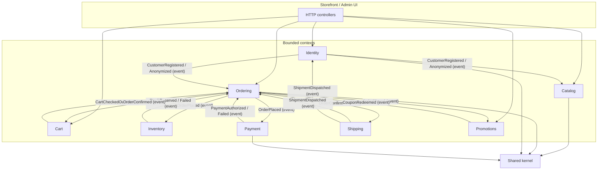
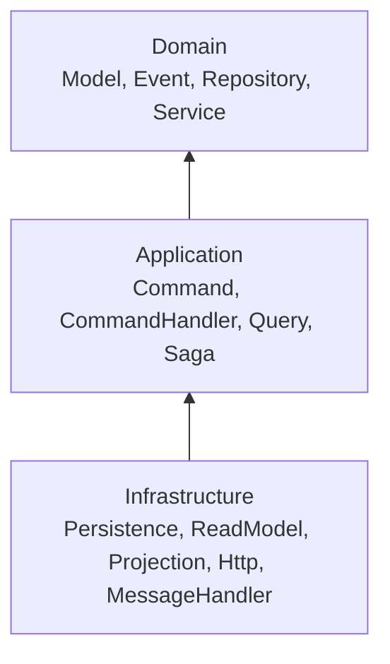
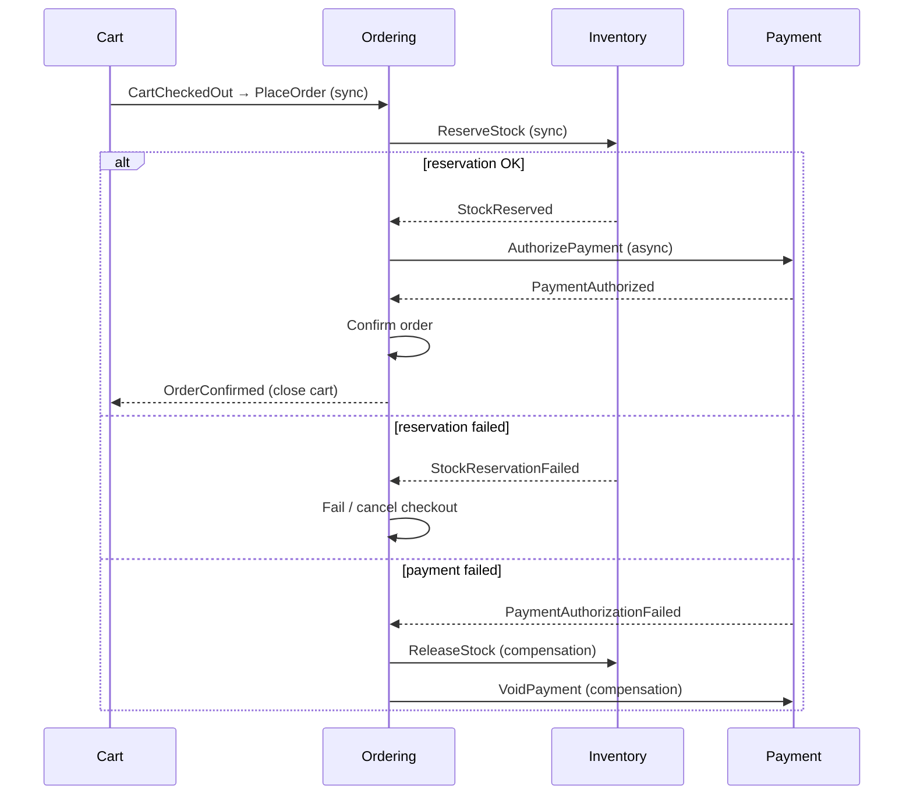

# Architecture overview

## Context map

Eight bounded contexts plus **Shared**. Cross-context integration uses **domain events** (async via outbox) or **application ports** (anti-corruption at checkout quote time)—never direct aggregate-to-aggregate calls across context folders (Deptrac).

## CQRS layering (per context)

Each context follows the same dependency direction:

| Layer | Responsibility | Typical types |
|-------|----------------|---------------|
| **Domain** | Invariants, aggregates, domain events, repository **interfaces** | `Product`, `Order`, `OrderStatus` |
| **Application** | Use cases: commands/queries (DTOs), handlers, sagas | `PlaceOrder`, `PlaceOrderHandler`, `CheckoutSaga` |
| **Infrastructure** | ORM entities mapping, DBAL read models, HTTP, outbox relay | `Product` (ORM), `*Finder`, controllers |

**Write path:** HTTP → `command.bus` → command handler (transaction boundary) → aggregate → outbox (same TX) → relay → `event.bus`.

**Read path:** HTTP → `query.bus` → query handler (DBAL only, QRY-001) → DTO / `*_view` row.

## Checkout saga (process manager)

Entry: `Ordering\Application\Saga\CheckoutSaga` (**Target**; ADR-0004).

## Shared kernel (cross-cutting domain)

| Class | Role | Status |
|-------|------|--------|
| `AggregateRoot` | Records domain events on aggregates | **Implemented** |
| `Money`, `Currency` | ECO-001 money type | **Implemented** |
| `OutboxPort` | Append events in same transaction as write | **Implemented** (port + infra) |

See [DOMAIN-CLASS-DIAGRAMS.md](./DOMAIN-CLASS-DIAGRAMS.md#shared-kernel).
