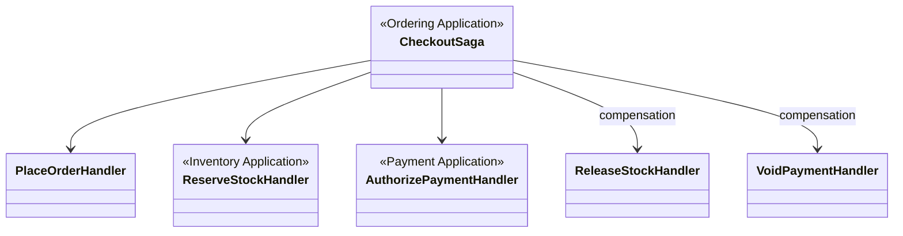

# Cross-context integration

## Domain events (ADR-0001)

| Event | Publisher (class / context) | Subscribers | Relation to domain |
|-------|------------------------------|-------------|-------------------|
| `CartCheckedOut` | `Cart` | `Ordering` (`CheckoutSaga`) | Triggers `PlaceOrder`; cart lines → order line snapshots |
| `OrderPlaced` | `Order` / Ordering | Payment, Inventory, Promotions | Starts parallel auth + reserve + coupon hold |
| `StockReserved` | `StockItem` / Inventory | Ordering saga | Allows payment step |
| `StockReservationFailed` | Inventory | Ordering saga | Aborts checkout; no order confirm |
| `PaymentAuthorized` | `Payment` | Ordering saga | Confirms order |
| `PaymentAuthorizationFailed` | Payment | Ordering saga | Triggers `ReleaseStock`, `VoidPayment` |
| `OrderConfirmed` | `Order` | Shipping, Cart | Creates shipment; closes cart |
| `ShipmentDispatched` | `Shipment` | Ordering, Identity | Updates order status; notification |
| `CustomerRegistered` | `Customer` | Projections | PII in read models |
| `CustomerAnonymized` | `Customer` | Ordering/Catalog projections | RG3.4 retention |
| `CouponRedeemed` | Promotions | Ordering | Redemption count / audit |

Events are persisted through **Shared** outbox (`OutboxPort` → `outbox` table) in the **same transaction** as the aggregate write (EVT-002).

## Identifier references (allowed cross-context relations)

| Identifier | Defined in | Referenced from |
|------------|------------|-----------------|
| `ProductId` | Catalog | Cart lines, Order lines (optional), Inventory, Wishlist |
| `CustomerId` | Identity | Cart, Order, Reviews |
| `OrderId` | Ordering | Payment, Inventory reservation, Shipment |
| `CategoryId` | Catalog | Product, Promotion scope |
| `PromotionId` / promo code string | Promotions | Order (snapshot fields only) |

**Not allowed:** Doctrine associations or PHP type hints from `App\Ordering\Domain` to `App\Catalog\Domain\Model\Product`.

## Checkout: class-level collaboration

Saga orchestrates **handlers** (application layer), not foreign aggregates directly—preserves bounded context boundaries.

## Read-model projections (event → table)

| Projection handler | Source events | Target read model |
|--------------------|---------------|-------------------|
| `ProjectCatalogProductView` | `ProductRegistered`, `ProductPriceChanged` | `catalog_product_view`, `storefront_product_view` |
| `IndexCatalogSearchDocument` | catalog product events | Meilisearch (ECO-008) |
| Customer/order finders | various | `customer_profile`, `ordering_orders` (partial) |

Projections are **Infrastructure**; they do not appear on domain class diagrams except as notes.

## Consistency boundaries

| Boundary | Consistency | Classes involved |
|----------|-------------|------------------|
| Single aggregate command | Strong (one TX) | One `AggregateRoot` + outbox |
| Checkout sync slice | Strong | `PlaceOrder` + `ReserveStock` (same command bus TX policy per handler design) |
| Payment authorization | Eventual | `Payment` + webhook handlers |
| Storefront catalog browse | Eventual | Projections lag behind write model |

See [ARCHITECTURE-OVERVIEW.md](./ARCHITECTURE-OVERVIEW.md) for saga sequence.
