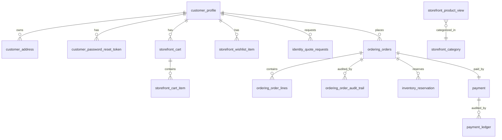

# Database architecture — `ecommerce-core`

PostgreSQL 16. Schema is managed by Doctrine Migrations (`migrations/`). Conventions and decisions follow the ADRs in `docs/adr/`. Money is stored as integer **minor units** (ECO-001); timestamps are `timestamptz` (UTC). Primary keys are UUID v7 unless noted.

## Conventions

- **Schema-per-context naming**: tables are prefixed by their bounded context (`ordering_`, `storefront_`, `customer_`, `identity_`, `inventory_`, `payment_`, `catalog_`). Cross-context references are UUIDs without FKs (ID-only, per CROSS-CONTEXT-INTEGRATION).
- **Write vs read models**: write aggregates (e.g. `ordering_orders`) hold invariants; read models (`*_view`, `storefront_product_view`) are denormalized projections rebuilt by replay (MIG-002).
- **Outbox**: `outbox` + `processed_events` (+ `processed_commands`) implement the transactional outbox and idempotent consumers (EVT-002/EVT-003).
- **OCC**: aggregates that mutate concurrently carry a `version` column (`ordering_orders`, `payment`).
- **Audit**: append-only audit tables (`ordering_order_audit_trail`, `identity_audit_log`, `catalog_audit_log`, `payment_ledger`).
- **Singletons**: `storefront_shipping_policy`, `platform_setting`, `storefront_banner` enforce a single row via `CHECK (id = 1)`.

## Context map (tables)

### Shared kernel
| Table | Purpose |
|-------|---------|
| `outbox` | Transactional outbox: `id, aggregate_type, aggregate_id, event_type, payload (json), occurred_on, published_at` |
| `processed_events` | Idempotent consumer dedup: PK `(consumer, event_id)` |
| `processed_commands` | Command idempotency keys |

### Catalog (write + read)
| Table | Purpose |
|-------|---------|
| `catalog_products` | Minimal write model (`id, name, price_minor, currency`) |
| `catalog_product_view` | Minimal read projection (`id, name, price_minor, currency`) |
| `storefront_product_view` | Main catalog read model: slug, name, brand, ref, category/subcategory, price_minor, old_price_minor, currency, stock, material, dims, image_path, additional_images (json), rating, reviews, is_new, is_best, headrest, description, variants (json), stock_quantity (nullable cache of `inventory_stock`), approval workflow columns (approval_status, submitted_by/at, reviewed_by/at, rejection_reason, published) |
| `storefront_category` | Category taxonomy: slug (PK), label, subcategories (json), quote_eligible, sort_order, parent_slug, hidden, approval workflow columns |
| `storefront_brand` | Brand names (PK name) |
| `catalog_audit_log` | Append-only catalog workflow actions (target_type, target_slug, actor_id, reason) |
| `catalog_submission` | Approval write model (spec-run-15 R1): PK (kind, slug), kind in {products, categories}, approval_status in {PENDING_APPROVAL, APPROVED, REJECTED}, submitted_by/at, reviewed_by/at, rejection_reason, updated_at. Sole authoritative source of approval state; view columns are a synchronous projection. |

### Cart
| Table | Purpose |
|-------|---------|
| `storefront_cart` | One cart per customer: PK id, customer_id (unique), created/updated_at |
| `storefront_cart_item` | Lines: cart_id (FK cascade), product_slug, variant_label, quantity, unit_price_minor, currency; unique `(cart_id, product_slug, COALESCE(variant_label,''))` |

### Ordering
| Table | Purpose |
|-------|---------|
| `ordering_orders` | Aggregate: id, customer_id, status, order_number, subtotal/discount/delivery/total_minor, currency, delivery_method, payment_method, promo_code, placed_at, version (OCC), order_source (ONLINE/PROXY), customer_name/phone, shipping_address, created_by_admin_id, admin_notes |
| `ordering_order_lines` | Lines: order_id (FK cascade), product_slug, product_name, variant_label, unit_price_minor, currency, quantity |
| `ordering_order_audit_trail` | Append-only status/version transitions (from/to status, from/to version, changed_by, reason, created_at) |

### Inventory
| Table | Purpose |
|-------|---------|
| `inventory_stock` | Stock authority (spec-run-15 R14): PK product_slug, on_hand, reserved, updated_at; available = on_hand - reserved. `storefront_product_view.stock_quantity` is a synchronous cache rebuilt by projection replay (`inventory-stock`). |
| `inventory_reservation` | Composite PK (order_id, product_slug): quantity, status (reserved/released), created_at, released_at |

### Payment
| Table | Purpose |
|-------|---------|
| `payment` | Aggregate per order (unique order_id): method, amount_minor, currency, status, version, provider_reference, created/updated_at |
| `payment_ledger` | Append-only ledger: payment_id (FK), from/to status, version, amount_minor, actor_id, reason, created_at |

### Identity
| Table | Purpose |
|-------|---------|
| `customer_profile` | Account: id, name, email (unique lowercased), phone, account_type, company, mf, password_hash, google_id (unique partial), role, status, ban_reason, banned_by, banned_at, created_at, updated_at |
| `customer_address` | Addresses: customer_id, name, phone, street, city, governorate, zip, created_at |
| `customer_password_reset_token` | Reset tokens: customer_id, token_hash, expires_at, used_at, created_at |
| `identity_quote_requests` | Quote requests: user_id (nullable), full_name, email, phone, city, category, subcategories (json), message, status, created_at |
| `identity_audit_log` | Append-only identity actions (action, target_user_id, actor_admin_id, reason, created_at) |

### Storefront engagement / content
| Table | Purpose |
|-------|---------|
| `storefront_contact_message` | Contact form submissions |
| `storefront_newsletter_subscriber` | Newsletter emails (unique) |
| `storefront_product_review` | Product reviews (product_slug, author_name, rating, comment, created_at) |
| `storefront_wishlist_item` | Wishlist: customer_id, product_slug (unique pair) |
| `storefront_faq_entry` | FAQ (category, question, answer, sort_order) |

### Platform / reference
| Table | Purpose |
|-------|---------|
| `platform_setting` | Singleton: contact_phone, contact_whatsapp, auto_cancel_minutes, payment_methods (json), updated_at |
| `storefront_shipping_policy` | Singleton: delivery_fee_minor, free_delivery_threshold_minor |
| `storefront_promo_code` | Promo codes: code (PK), discount_basis_points, active |
| `storefront_governorate` | Governorates list with sort_order |
| `storefront_banner` / `storefront_banner_image` | Site banner ordered image set |

## Relationship diagram (logical)

## Indexing & performance

- Keyset pagination indexes follow ADR-0009 (e.g. `ordering_orders (customer_id, placed_at DESC, id DESC)`).
- Unique functional index `uniq_customer_profile_email_lower` on `lower(email)` (spec-run-12 R7–R9).
- Partial unique index on `google_id WHERE google_id IS NOT NULL`.
- Outbox partial index `WHERE published_at IS NULL`.

## Notes

- Cross-context FKs are intentionally absent; cleanup of orphaned rows (cart, wishlist, reset tokens) is handled in application handlers.
- Read models (`storefront_product_view`, `catalog_*_view`) are rebuilt by projection replay (MIG-002, `bin/console projection:replay <name>`): `catalog-product-view`, `catalog-submission`, `inventory-stock`. Migrations never rewrite projection rows except the allowlisted unit-conversion migration `Version20261029000003`.
- All migrations are reversible except where noted (`Version20261025000000`).
