# Domain class diagrams

Notation: Mermaid `classDiagram`. Relations use UML stereotypes where helpful.

**Relation types used**

| Symbol / keyword | Meaning |
|------------------|---------|
| `<\|--` | Generalization (inheritance) |
| `*--` | Composition (child lifecycle bound to parent) |
| `o--` | Aggregation (shared reference, weaker ownership) |
| `-->` | Association / dependency (uses, references by ID) |
| `..>` | Dependency (e.g. handler → aggregate) |

**Cross-context rule:** associations between aggregates in **different** contexts are **by identifier only** (`ProductId`, `CustomerId`, `OrderId`)—never object references. Integration is via events or ACL ports ([CROSS-CONTEXT-INTEGRATION.md](./CROSS-CONTEXT-INTEGRATION.md)).

---

## Shared kernel

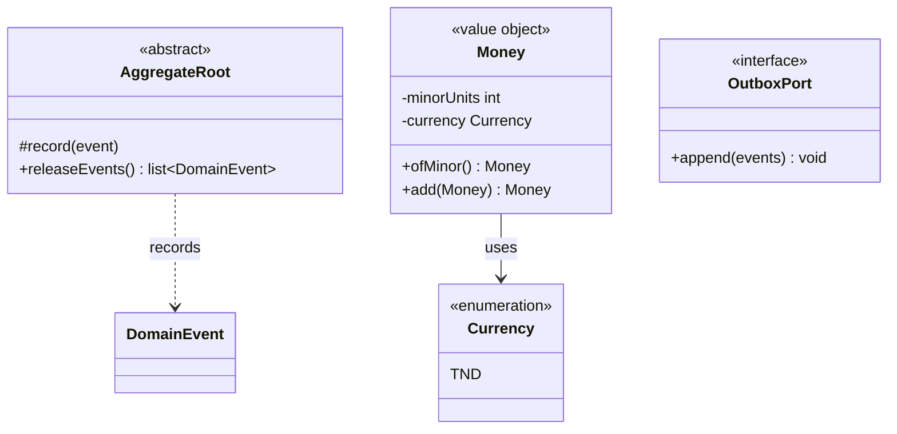

| From | To | Type | Multiplicity | Notes |
|------|-----|------|--------------|-------|
| `Money` | `Currency` | association | 1 → 1 | ISO 4217 code |
| `AggregateRoot` | domain events | dependency | 1 → 0..* | Released to outbox in infra |
| Command handlers | `OutboxPort` | dependency | — | Same transaction as persist |

---

## Catalog

**BRD:** category tree (RG1.x), single category per product (RG1.1), product reviews on storefront.

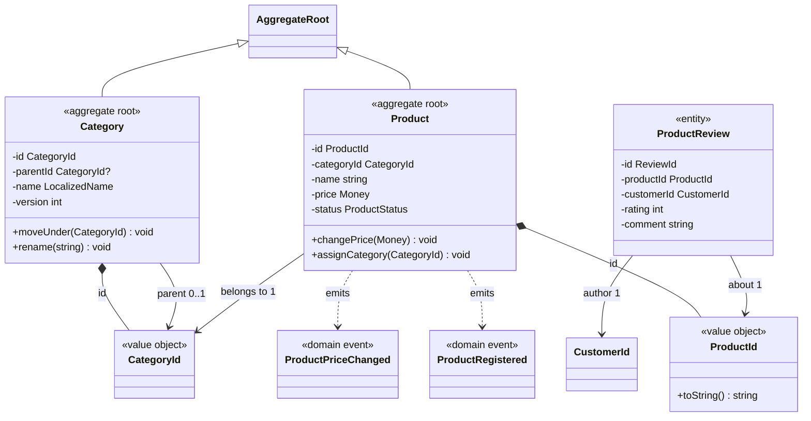

| From | To | Type | Multiplicity | Rule / note |
|------|-----|------|--------------|-------------|
| `Category` | `Category` (parent) | association | 0..1 parent, 0..* children | Tree, no cycles (RG1.2) |
| `Product` | `Category` | association | * → 1 | Single category (RG1.1) |
| `Product` | `ProductReview` | composition | 1 → 0..* | Reviews stored per product slug in DB today |
| `Product` | `AggregateRoot` | inheritance | — | **Implemented** for `Product` only |
| `Category` | — | — | — | **Target** aggregate; hierarchy validation exists in application service |

**Read side (not domain, for orientation):** `StorefrontProductView`, `catalog_product_view` — denormalized projection; **Implemented**.

---

## Cart

**BRD RG4.1:** cart for logged-in customers only; high churn, separate from orders (ADR-0001).

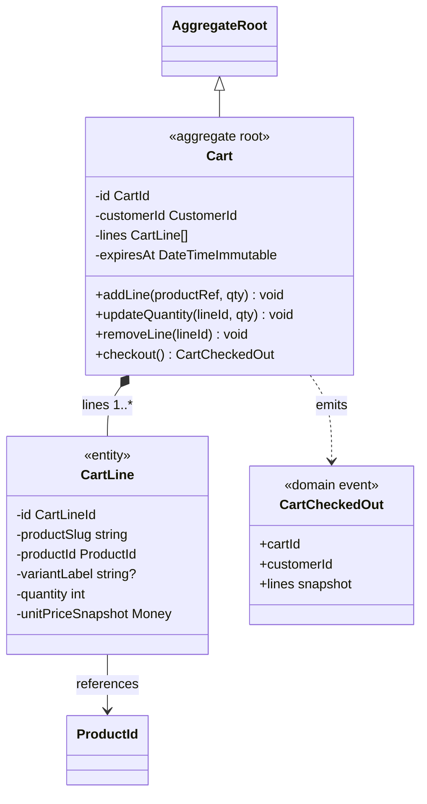

| From | To | Type | Multiplicity | Note |
|------|-----|------|--------------|------|
| `Cart` | `CartLine` | composition | 1 → 0..* | Lines die with cart |
| `Cart` | `CustomerId` | association | * → 1 | Identity context ID only |
| `CartLine` | `Product` | dependency | — | ID + price snapshot at add time |
| `Cart` | `Ordering` | event | 1 checkout → 1 order | `CartCheckedOut` |

**Status:** **Target** aggregate; **Implemented** read path: `QuoteCart`, `CartQuote`, storefront quote via ports.

---

## Ordering

**BRD:** online orders + phone/WhatsApp proxy orders; immutable line snapshots (ECO-006); optimistic version (RP1.x).

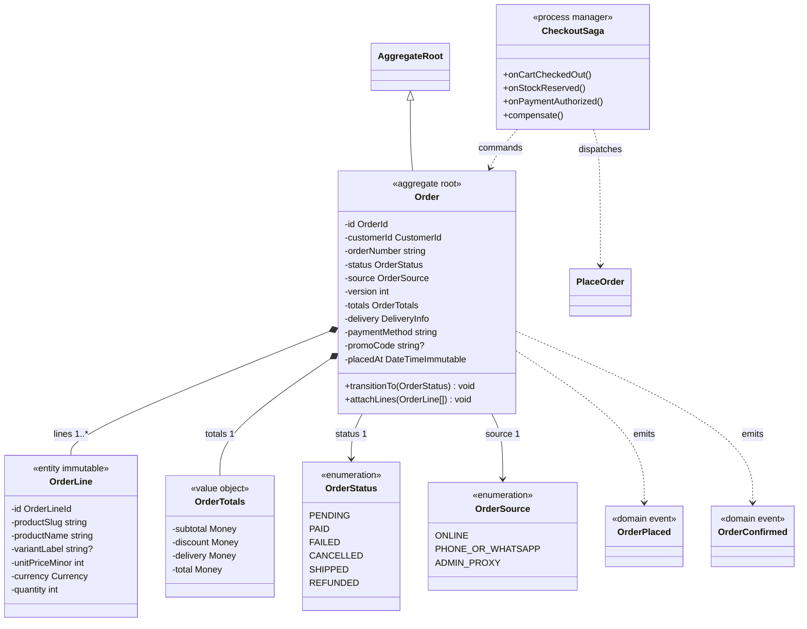

| From | To | Type | Multiplicity | Note |
|------|-----|------|--------------|------|
| `Order` | `OrderLine` | composition | 1 → 1..* | Snapshot at place time (ECO-006) |
| `Order` | `CustomerId` | association | * → 1 | May be anonymized later (RG3.4) |
| `Order` | `Product` | — | — | **No link**; only line snapshots |
| `OrderStatus` | state machine | — | — | **Implemented** enum + transitions |
| `Order` | ORM/table | — | — | **Partial** `ordering_orders`, `ordering_order_lines` |
| `CheckoutSaga` | buses | dependency | — | **Target** (ADR-0004) |

**Application commands (relation to domain):**

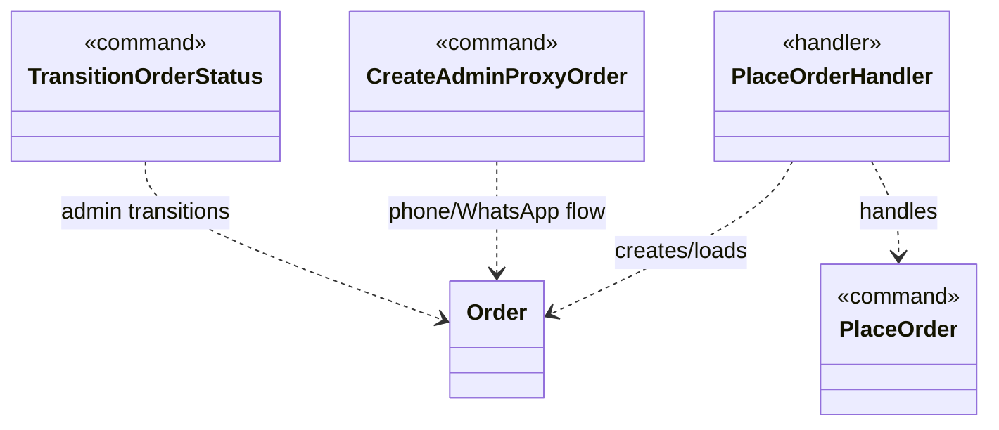

---

## Inventory

**BRD RC1–RC2, ECO-004:** atomic stock decrement; reservations for pending orders.

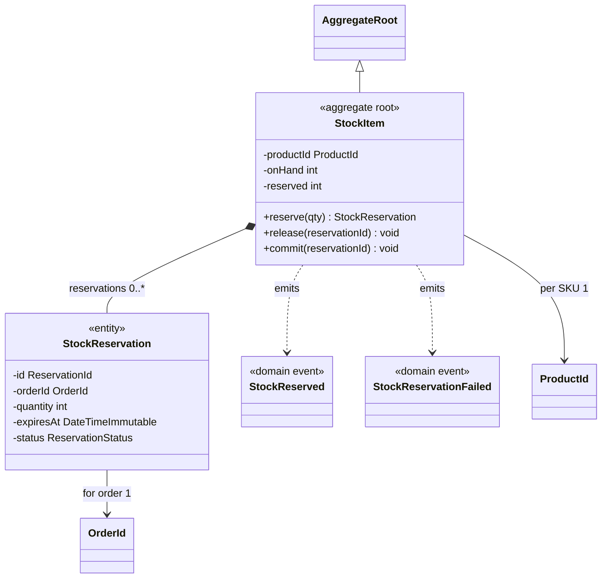

| From | To | Type | Multiplicity | Note |
|------|-----|------|--------------|------|
| `StockItem` | `ProductId` | association | 1 → 1 | Cross-context ID |
| `StockReservation` | `OrderId` | association | * → 1 | Tied to checkout saga |
| `StockItem` | `StockReservation` | composition | 1 → 0..* | Released on timeout (RC9) |

**Status:** **Target**; storefront shows stock label on `storefront_product_view` (**Implemented** read-only).

---

## Payment

**BRD RP1.x, SEC-001:** payment decoupled from order; append-only ledger; provider tokens only.

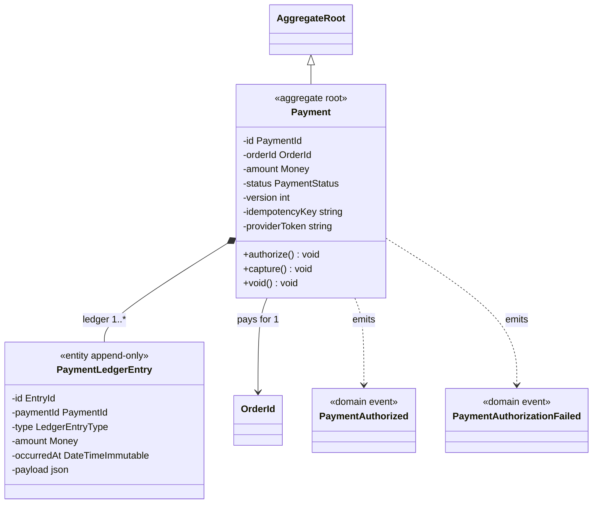

| From | To | Type | Multiplicity | Note |
|------|-----|------|--------------|------|
| `Payment` | `Order` | association | * → 1 | By `OrderId` only |
| `Payment` | `PaymentLedgerEntry` | composition | 1 → 1..* | Audit trail, no update/delete |
| `Payment` | card PAN/CVV | — | — | **Forbidden** (SEC-001) |

**Status:** **Target**; human approval required for `src/Payment/**` changes.

---

## Shipping

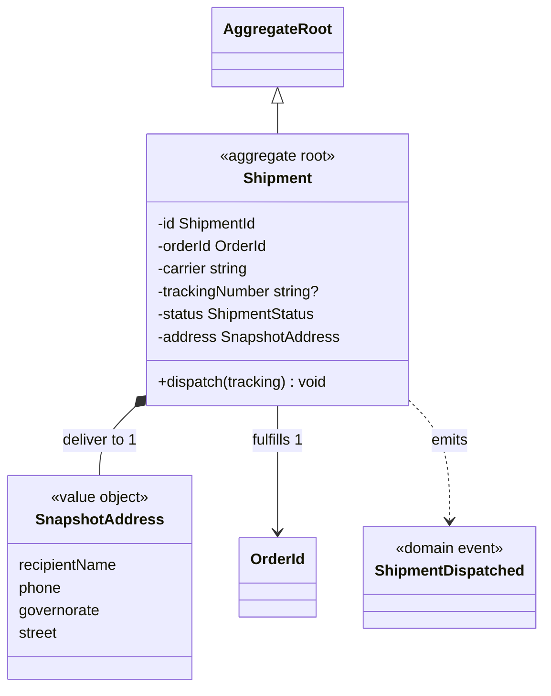

| From | To | Type | Multiplicity | Note |
|------|-----|------|--------------|------|
| `Shipment` | `Order` | association | 0..1 → 1 | Created after `OrderConfirmed` |
| `SnapshotAddress` | `CustomerAddress` | — | — | Copied at ship time, not live reference |

**Status:** **Target**; reference data `storefront_shipping_policy` exists (**Implemented**).

---

## Identity

**BRD RG3.x:** customers, admins, super-admin, addresses, wishlist, audit.

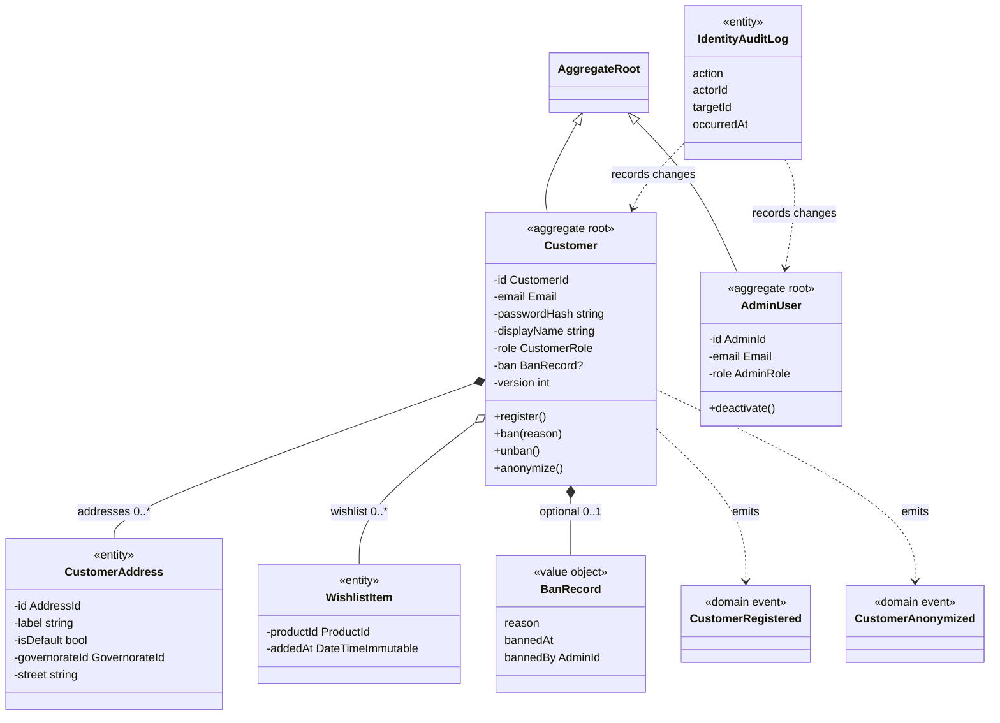

| From | To | Type | Multiplicity | Note |
|------|-----|------|--------------|------|
| `Customer` | `CustomerAddress` | composition | 1 → 0..* | **Implemented** tables `customer_profile`, `customer_address` |
| `Customer` | `WishlistItem` | aggregation | 1 → 0..* | **Implemented** `storefront_wishlist_item` |
| `AdminUser` | `Customer` | — | — | Admin actions via commands, not inheritance |
| `Customer` | `Order` | — | — | Linked by `CustomerId` in Ordering |

**Infrastructure security (separate from domain):** `CustomerUser` implements Symfony `UserInterface` — adapter, not core domain model.

---

## Promotions

**BRD RG2.x:** time windows, best discount wins, promo codes.

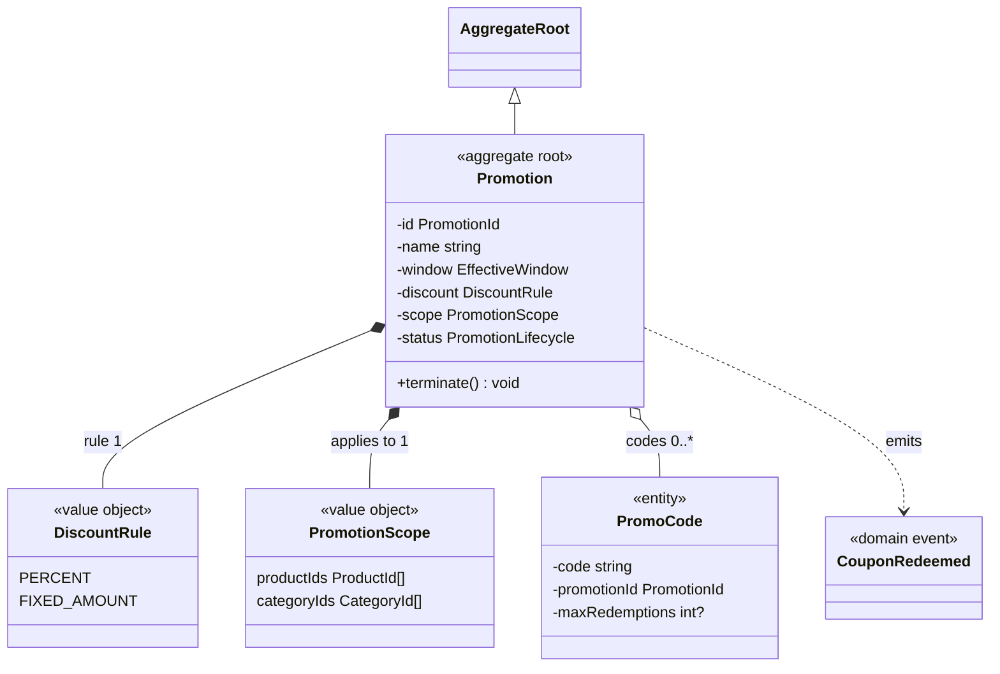

| From | To | Type | Multiplicity | Note |
|------|-----|------|--------------|------|
| `Promotion` | `Product` / `Category` | association | — | By ID lists only |
| `PromoCode` | `Order` | event | — | `CouponRedeemed` on successful checkout |
| Storefront pricing | `Promotion` | ACL | — | **Implemented** `ValidatePromoCode`, `storefront_promo_code` read model |

---

## Application ports (anti-corruption at quote time)

Used by Cart/Ordering to read Catalog + Promotions without importing their aggregates:

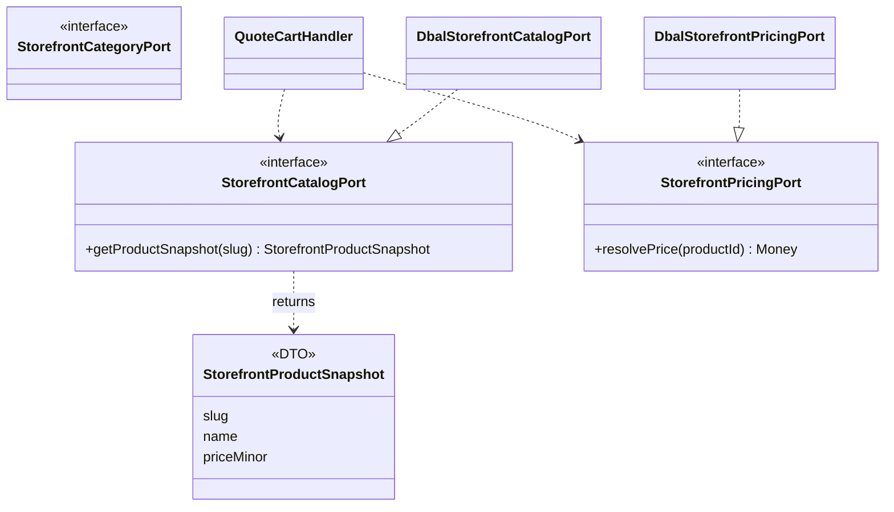

| From | To | Type | Note |
|------|-----|------|------|
| `Cart` application | `StorefrontCatalogPort` | dependency | ACL in Shared/Application |
| Infra adapters | Catalog read tables | dependency | DBAL, not domain import |

---

## Global relation summary (aggregates only)

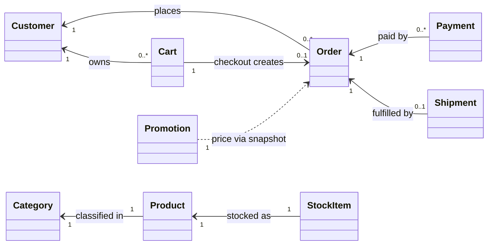

All links above are **logical** (IDs + events), not PHP object graphs across `src/<Context>` namespaces.
